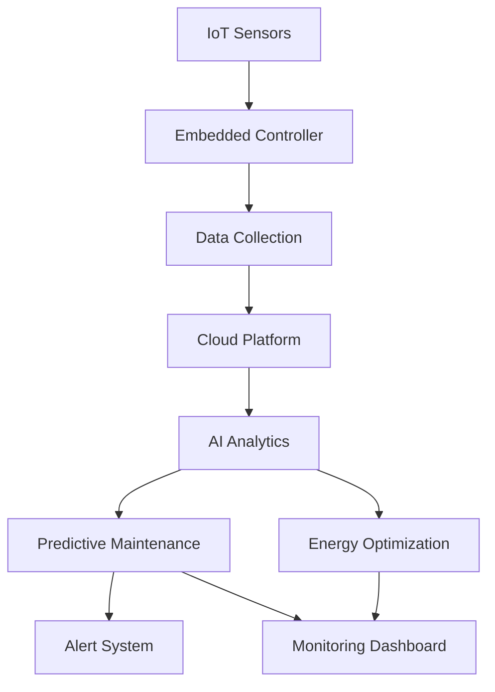

# Ex.No.4 – EXP 4: Generate the Prompt and Evaluate Different Prompt Patterns

### DATE: 05-11-2026

### REGISTER NUMBER: 212224240130

## Aim

To write prompts for different prompt engineering techniques and compare their outputs using Generative AI tools (ChatGPT, Google Gemini and Claude). The outputs are evaluated using a rubric-based evaluation method.

The prompt patterns covered are:

1. Zero-shot Prompting
2. Few-shot Prompting
3. Chain of Thought Prompting
4. Persona Pattern
5. Reverse Prompting
6. Graph Prompting
7. Active Prompting

## 1. Scenario and Use Case

**Scenario:** Smart Manufacturing Automation Using IoT and Predictive Maintenance

The manufacturing industry aims to reduce manual monitoring and improve operational efficiency through automation. The proposed system uses IoT sensors, embedded controllers and Artificial Intelligence to monitor machinery, automate equipment and predict possible machine failures.

**Target Audience:** Manufacturing companies, particularly in the automotive, electronics and food processing industries.

**Main Objectives:**

- Improve production efficiency by 30%.
- Minimize machinery downtime using predictive maintenance.
- Enable real-time monitoring and remote control of manufacturing systems.
- Reduce energy consumption by optimizing production processes.
- Detect abnormal machine conditions before equipment failure.

## 2. Prompt Patterns for Idea Generation

**Comparative Analysis Prompt**
Definition: Asking for a comparison between two or more concepts, highlighting similarities and differences.
- "Compare and contrast deep learning and machine learning."
- "How do renewable and non-renewable energy sources differ?"

**Experiential Perspective Prompt**
- "As a software engineer, what are the benefits of using cloud computing in your projects?"
- "From a student's perspective, describe the challenges of online learning."

**Everyday Functioning Prompts**
- "Describe the role of machine learning in everyday apps like YouTube or Netflix."
- "How is encryption used in daily life when sending WhatsApp messages?"

**Universal Prompt Structures**
- "Explain [concept] in simple terms with an example."
- "Explain the process of [task] step by step."

**Prompt Size Limitations**
- "Translate this 5000-word essay into Tamil." → Manageable chunks: "Translate the first 1000 words into Tamil, then continue."
- "Give me 50 examples of AI applications." → Adjust for size: "Give me 10 AI applications at a time."

## 3. Prompt Generation Using Different Prompt Patterns

### 3.1 Zero-shot Prompting

Definition: The AI model is given a direct instruction without any examples.

Prompt:

```
You are an AI manufacturing automation assistant.

Explain how IoT and Artificial Intelligence can be used to
automate a manufacturing industry.

Include the following:
1. Real-time machine monitoring.
2. Predictive maintenance.
3. Production efficiency improvement.
4. Energy consumption optimization.
5. Benefits of automation.

Provide the answer in simple language with practical examples.
```

Expected Output:

IoT sensors collect real-time machine data such as temperature, vibration, pressure and energy consumption. AI algorithms analyze this data to identify abnormal conditions and predict equipment failures. Predictive maintenance helps manufacturers schedule maintenance before machinery breaks down. This reduces downtime, improves production efficiency and saves energy.

### 3.2 Few-shot Prompting

Definition: A few input-output examples are given so the model copies the expected format.

Prompt:

```
You are an AI-powered manufacturing automation assistant.

Study the following examples:

Example 1:
Input: Vibration = 2.1 mm/s, Temperature = 45°C
Output: Status: Normal | Action: No action needed.

Example 2:
Input: Vibration = 7.8 mm/s, Temperature = 78°C
Output: Status: Warning | Action: Schedule bearing inspection within 48 hours.

Example 3:
Input: Vibration = 12.4 mm/s, Temperature = 95°C
Output: Status: Critical | Action: Stop the machine and replace the bearing immediately.

Now analyze the following situation using the same format:

Input: Vibration = 9.3 mm/s, Temperature = 83°C
```

Expected Output:

Status: Warning | Action: Schedule bearing and cooling system inspection as soon as possible and monitor the machine continuously.

### 3.3 Chain of Thought Prompting

Definition: The AI is asked to reason step by step before giving the final answer.

Prompt:

```
You are an industrial AI analyst.

A factory has 10 machines. Each machine averages 40 hours of
unplanned downtime per year, and predictive maintenance reduces
this by 60%. Each machine uses 15 kW for 6,000 hours per year,
and process optimization cuts energy use by 12%.

Think step by step:
1. Calculate the downtime hours saved per machine and in total.
2. Calculate the energy saved in kWh per year.
3. State whether these results support the 30% efficiency
   objective and explain why.

Present the explanation step by step with a final summary.
```

Expected Output:

1. Downtime saved per machine = 40 × 0.60 = 24 hours. Total = 24 × 10 = 240 hours per year.
2. Energy per machine = 15 kW × 6,000 h = 90,000 kWh. Saving per machine = 90,000 × 0.12 = 10,800 kWh. Total = 108,000 kWh per year.
3. Downtime falls by 60% and energy by 12%, which shows strong improvement, but the 30% production efficiency target needs additional measures such as process optimization and real-time monitoring.

Summary: Predictive maintenance and energy optimization together reduce downtime and cost and move the plant toward the efficiency goal.

### 3.4 Persona Pattern

Definition: The AI is assigned a role so that its answer matches the expertise and perspective of that role.

Prompt:

```
Act as a Senior Industrial IoT Engineer with 10 years of
experience in manufacturing automation.

Design an intelligent manufacturing monitoring system and explain:
1. IoT sensor integration.
2. Embedded controller communication.
3. Real-time machine monitoring.
4. AI-based predictive maintenance.
5. Energy consumption optimization.
6. Remote equipment monitoring.

Recommend suitable technologies and explain how the system
improves manufacturing efficiency.

Present your response as a technical project proposal that a
non-technical plant manager can understand.
```

Expected Output:

As a Senior Industrial IoT Engineer, I recommend:

- Sensors: Temperature, vibration, pressure and current sensors.
- Controller: ESP32 or industrial PLC.
- Communication: MQTT protocol.
- Cloud Platform: AWS IoT or Azure IoT.
- Database: Time-series database such as InfluxDB or PostgreSQL.
- AI Model: Machine learning models for anomaly detection and failure prediction.
- Dashboard: Web-based monitoring interface.

The system continuously monitors equipment, detects abnormal conditions and generates maintenance alerts.

### 3.5 Reverse Prompting

Definition: The AI is given a desired output or objective and works backwards to construct the prompt that could produce it.

Prompt:

```
I want to develop an AI-powered smart manufacturing system with
these features:
1. Real-time IoT machine monitoring.
2. Predictive maintenance.
3. Machine failure alerts.
4. Energy consumption optimization.
5. Remote equipment control.

Work backwards from these requirements and write a detailed,
optimized prompt that I can give to an AI system to get a
complete technical solution.

The generated prompt must include: system architecture,
hardware and software requirements, IoT communication protocols,
AI model selection, database design, implementation steps and
expected outcomes.
```

Expected Output:

The AI generates an optimized prompt such as:

"Act as an Industrial IoT Solution Architect and design a smart manufacturing automation system using IoT sensors, embedded controllers, cloud computing and AI-based predictive maintenance. Explain the system architecture, hardware components, communication protocols, database design, AI models, implementation process and expected benefits."

### 3.6 Graph Prompting

Definition: Information is represented as nodes and relationships (a graph) instead of plain text.

Prompt:

```
Represent an AI-powered smart manufacturing system as a graph.

Nodes: IoT Sensors, Embedded Controller, Data Collection,
Cloud Platform, AI Analytics, Predictive Maintenance,
Alert System, Monitoring Dashboard, Energy Optimization.

1. List the edges in the form (Source → Relationship → Target).
2. Explain the data flow from sensor data collection to
   AI-based decision making.
3. Output the graph as a Mermaid flowchart.
```

Expected Output:



Explanation: Sensors collect machine data, the controller transmits it, the cloud stores and processes it, AI analytics detects abnormal patterns, and the results go to maintenance, energy optimization, alerts and the dashboard.

### 3.7 Active Prompting

Definition: The AI generates several answers, finds the points where it is uncertain or the answers disagree, and asks the user to clarify only those points before giving the final answer.

Prompt:

```
Act as an Industrial AI Consultant.

Generate 3 different answers to this question:
"What is the best way to reduce energy consumption in a food
processing plant using IoT?"

Compare the answers and identify the points where they disagree
or where you are uncertain. Ask me clarifying questions on only
those points. After I reply, produce one final refined answer
with architecture, hardware, software and implementation steps.
```

Expected Output:

The AI asks questions such as:

1. Which processes use the most energy (refrigeration, heating, conveyors)?
2. Are smart energy meters already installed?
3. What is the available budget?

After the replies, the AI produces one customized and refined energy-saving solution.

## 4. Comparison of Different AI Tools

The same 7 prompts were executed on ChatGPT, Google Gemini and Claude.

| Prompt Pattern   | ChatGPT | Google Gemini | Claude |
| ---------------- | ------- | ------------- | ------ |
| Zero-shot        | Clear, well-structured explanation with practical examples; slightly generic | Good contextual explanation with real-world examples; a bit lengthy | Concise and organized answer covering all 5 points in simple language |
| Few-shot         | Followed the Status \| Action format exactly and classified the reading as Warning | Followed the format with a small extra explanation added | Matched the format exactly, classified as Warning and gave a precise action |
| Chain of Thought | Correct calculations (240 hours, 108,000 kWh) with clear steps | Correct steps; the final judgement on the 30% target was less detailed | Correct calculations and an explicit explanation of why the 30% target needs more than downtime and energy savings |
| Persona          | Strong technical proposal with a proper tool stack | Good role-based recommendations; slightly more technical for a plant manager | Technical proposal in the engineer's voice, still easy for a non-technical manager |
| Reverse          | Produced a detailed, reusable optimized prompt | Produced a prompt plus alternative versions | Produced a well-structured prompt with all required sections |
| Graph            | Listed edges correctly and gave valid Mermaid code | Gave a good graph-style flow and diagram, minor syntax adjustment needed | Clean edge list, valid Mermaid flowchart and clear flow explanation |
| Active           | Generated 3 answers and asked relevant questions | Asked relevant questions but did not clearly separate the uncertain points | Identified the points of disagreement and asked focused questions only on those |

## 5. Evaluation Using Rubrics

Evaluation Method: Rubric-Based Evaluation. Each criterion is scored from 1 (poor) to 5 (excellent).

| Evaluation Criteria | Marks | What is checked |
| ------------------- | ----- | --------------- |
| Accuracy            | 5     | Is the technical content correct? |
| Relevance           | 5     | Is it relevant to manufacturing IoT? |
| Clarity             | 5     | Is it easy to read and well organized? |
| Completeness        | 5     | Are all parts of the prompt answered? |
| Total               | 20    | |

### Detailed Scores

**ChatGPT**

| Prompt Pattern   | Accuracy | Relevance | Clarity | Completeness | Total /20 |
| ---------------- | -------- | --------- | ------- | ------------ | --------- |
| Zero-shot        | 4 | 5 | 4 | 4 | 17 |
| Few-shot         | 5 | 4 | 5 | 4 | 18 |
| Chain of Thought | 5 | 4 | 4 | 5 | 18 |
| Persona          | 4 | 5 | 4 | 5 | 18 |
| Reverse          | 4 | 4 | 5 | 4 | 17 |
| Graph            | 4 | 5 | 5 | 4 | 18 |
| Active           | 4 | 4 | 4 | 5 | 17 |

**Google Gemini**

| Prompt Pattern   | Accuracy | Relevance | Clarity | Completeness | Total /20 |
| ---------------- | -------- | --------- | ------- | ------------ | --------- |
| Zero-shot        | 4 | 4 | 4 | 4 | 16 |
| Few-shot         | 4 | 4 | 5 | 4 | 17 |
| Chain of Thought | 4 | 4 | 4 | 5 | 17 |
| Persona          | 4 | 5 | 4 | 5 | 18 |
| Reverse          | 4 | 4 | 4 | 5 | 17 |
| Graph            | 5 | 4 | 5 | 4 | 18 |
| Active           | 4 | 4 | 4 | 4 | 16 |

**Claude**

| Prompt Pattern   | Accuracy | Relevance | Clarity | Completeness | Total /20 |
| ---------------- | -------- | --------- | ------- | ------------ | --------- |
| Zero-shot        | 4 | 5 | 4 | 4 | 17 |
| Few-shot         | 5 | 5 | 5 | 4 | 19 |
| Chain of Thought | 5 | 5 | 4 | 5 | 19 |
| Persona          | 4 | 5 | 4 | 5 | 18 |
| Reverse          | 5 | 4 | 5 | 4 | 18 |
| Graph            | 5 | 5 | 5 | 4 | 19 |
| Active           | 4 | 5 | 4 | 5 | 18 |

### Final Scoring Table

| Prompt Pattern   | ChatGPT / 20 | Gemini / 20 | Claude / 20 |
| ---------------- | ------------ | ----------- | ----------- |
| Zero-shot        | 17 | 16 | 17 |
| Few-shot         | 18 | 17 | 19 |
| Chain of Thought | 18 | 17 | 19 |
| Persona          | 18 | 18 | 18 |
| Reverse          | 17 | 17 | 18 |
| Graph            | 18 | 18 | 19 |
| Active           | 17 | 16 | 18 |
| **Total (/140)** | **123** | **119** | **128** |

Evaluation Analysis:

- Zero-shot prompting gives quick responses but may lack specific technical details.
- Few-shot prompting improves consistency and output formatting because the examples set the pattern.
- Chain of Thought prompting is best for calculation and step-by-step reasoning.
- Persona prompting produces domain-specific recommendations in the right tone and depth.
- Reverse prompting helps generate optimized prompts from requirements.
- Graph prompting explains relationships between system components and can be converted into diagrams.
- Active prompting improves accuracy by clarifying uncertain points with the user, but needs more back-and-forth.
- Overall, all three tools performed well. Claude scored highest in format-following and reasoning tasks, ChatGPT was consistent across all patterns, and Gemini was strong in Persona and Graph prompting.

## 6. Result

The seven prompt engineering techniques were successfully designed and applied to the Smart Manufacturing Automation use case. The outputs from ChatGPT, Google Gemini and Claude were compared using a rubric based on accuracy, relevance, clarity and completeness.

Thus, selecting an appropriate prompt pattern improves the quality, structure and usefulness of AI-generated solutions.
